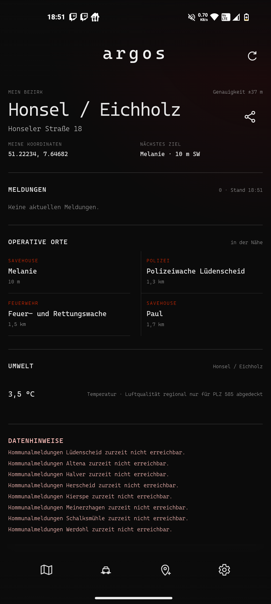
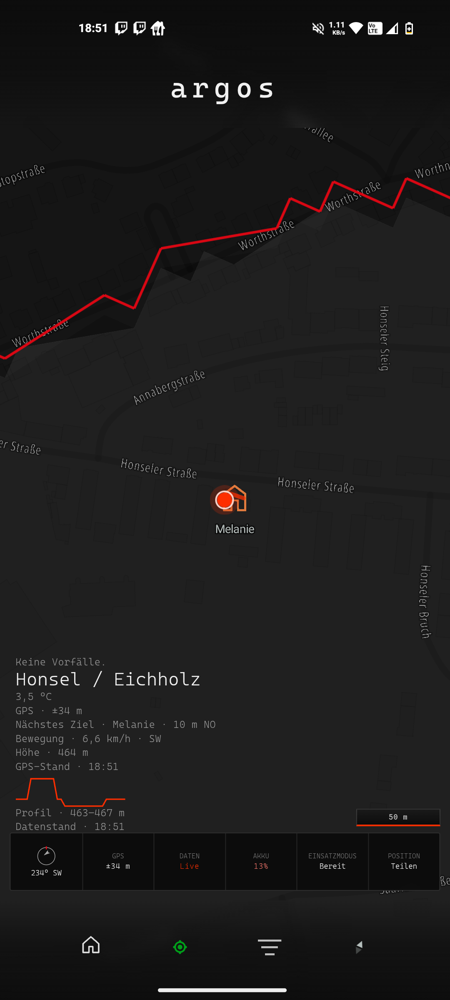
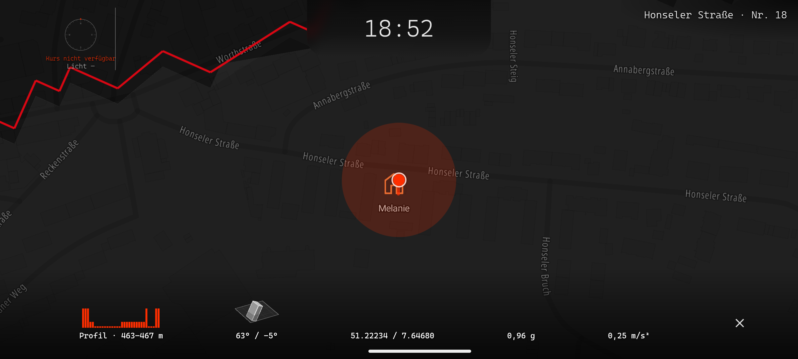
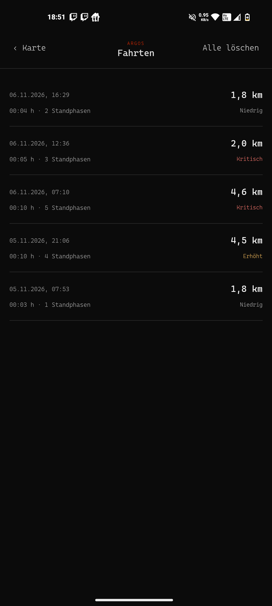
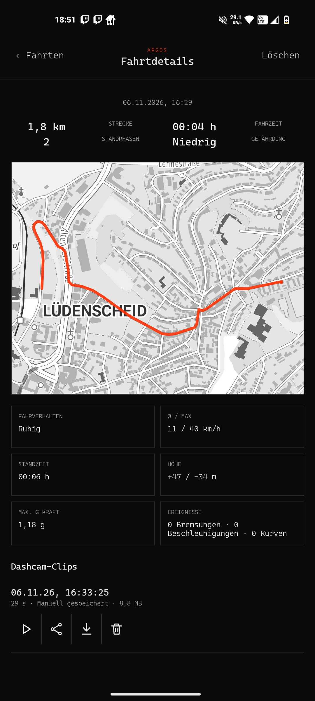
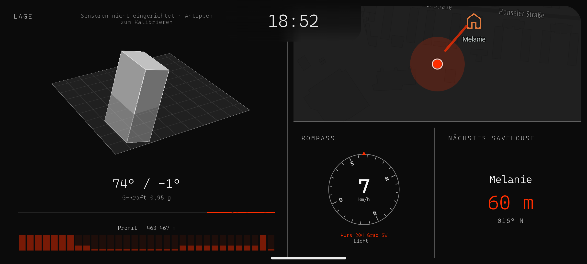
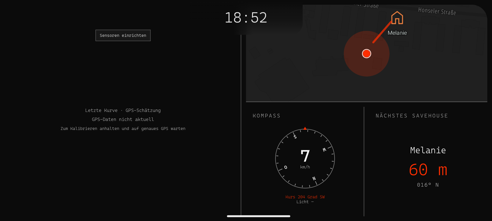

# Bit.UiDesign

## Operative Designkonzept

Dieses Repository beschreibt eine ruhige, datenorientierte UI-Sprache für operative Anwendungen. Sie priorisiert Lagebewusstsein, Messwerte, Zustände und direkte Handlungsfähigkeit vor dekorativer Gestaltung. Jede Ansicht verfolgt eine Hauptaufgabe: aktuelle Lage erfassen, eine Fahrt bewerten oder einen Sensorzustand prüfen.

Die verbindlichen Regeln, Tokens und Komponenten sind in [UI-DESIGN.md](UI-DESIGN.md) festgelegt. Die folgenden Screens zeigen die beabsichtigte Anwendung der Sprache.

## Gestaltungsprinzipien

- **Dunkle, belastbare Arbeitsfläche:** Fast schwarzer Hintergrund, helle Monospace-Typografie und feine graue Trennlinien schaffen Kontrast ohne visuelle Unruhe.
- **Information vor Dekoration:** Große Kennzahlen, Karten und Statuswerte erhalten Fläche; sekundäre Angaben bleiben klein und gedämpft. Flächen, Schatten und Rundungen werden nur eingesetzt, wenn sie die Bedienung oder Lesbarkeit verbessern.
- **Semantische Akzente:** Rot kennzeichnet kritische oder hervorgehobene operative Daten, Grün aktive Auswahl bzw. Navigation, Gelb Warnungen. Jede Farbmarkierung wird zusätzlich textlich oder ikonisch erklärt.
- **Technische Typografie:** Cascadia Code mit tabellarischen Ziffern sorgt für vergleichbare Messwerte, klare Zeitangaben und eine sachliche operative Anmutung.
- **Klare Gliederung:** Linien und rechteckige Datenfelder strukturieren zusammengehörige Informationen. Schwebende, weich gerundete Overlays bleiben auf dynamische Karten- und Liveansichten beschränkt.

## Informationshierarchie und Layout

Mobil folgt die Oberfläche einer vertikalen Priorität: zentrale Lage oder Kennzahl, aktuelle Meldungen, operative Ziele und unterstützende Details. Die untere Navigation enthält wenige gleich breite Ziele; der aktive Bereich wird ausschließlich grün markiert.

Auf großen Displays erhält die primäre Arbeitsfläche zwei Drittel der Breite. Die verbleibende Spalte bündelt kontextnahe Informationen wie Karte, Kompass und nächstes Ziel. Die Ansichten bleiben auch bei fehlenden oder veralteten Daten handlungsfähig: Der Zustand wird direkt an der betroffenen Funktion erklärt und die mögliche Aktion – etwa Sensoren einrichten oder GPS kalibrieren – ist sichtbar.

## Anwendungsbeispiele

### Lage und operative Orte

Die Lageansicht verbindet Bezirk, Position, nächste Ziele, Meldungen und Umweltwerte in einer klaren Reihenfolge. Operative Orte werden als gleichwertige Einträge mit Typ, Name und Entfernung geführt; nicht verfügbare Daten erscheinen als textliche Hinweise statt als leere Dekoration.

### Live-Karte und Navigation

Die Kartenansicht macht die Position und das nächste Ziel zum dominanten Inhalt. Eine einzelne rote Route hebt die operative Verbindung hervor. Livewerte, Höhenprofil und Status erscheinen ergänzend als kompakte Messinstrumente oder als zurückhaltendes Overlay.

### Fahrtprotokoll und Analyse

Die Fahrtübersicht reduziert jeden Eintrag auf Zeitpunkt, Dauer, Standphasen, Distanz und Gefährdung. In der Detailansicht bildet die Karte den Schwerpunkt; vergleichbare Kennzahlen werden in scharf begrenzten Rechtecken dargestellt. Kritische Werte sind rot und zugleich als Text benannt.

### Sensor- und Fehlerzustände

Die Desktopansicht teilt die Fläche strikt zwischen Sensorlage, Karte, Kompass und Zielinformation. Fehlen Sensordaten oder ist GPS nicht aktuell, wird die Livevisualisierung nicht simuliert: Die Ansicht benennt Ursache, Datenqualität und die konkrete Kalibrieraktion.

## Qualitätsmaßstab

Neue Ansichten müssen die Token aus `UI-DESIGN.md` verwenden, Dark, Light und Automatik unterstützen und die Breakpoints 767, 768, 1023 und 1024 px prüfen. Status, Lade- und Fehlerzustände dürfen weder ausschließlich farblich noch nur implizit vermittelt werden. Bewegung bleibt funktional, kurz und bei reduzierter Bewegung deaktiviert.

